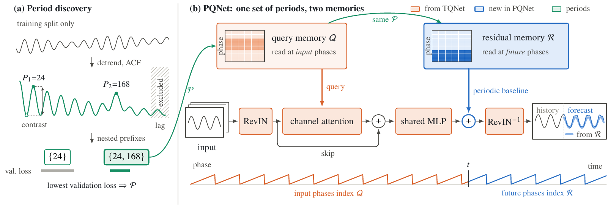
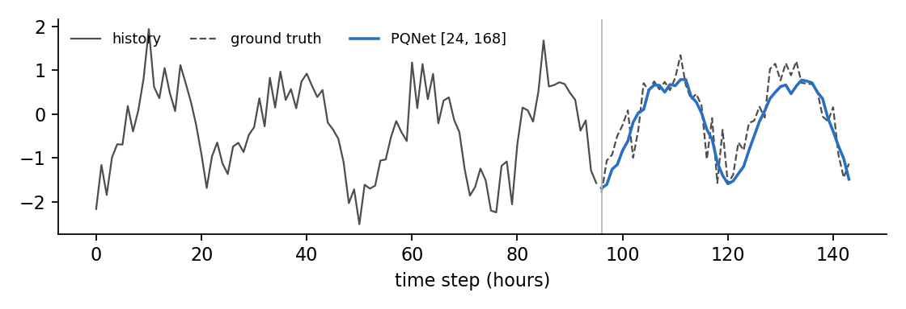
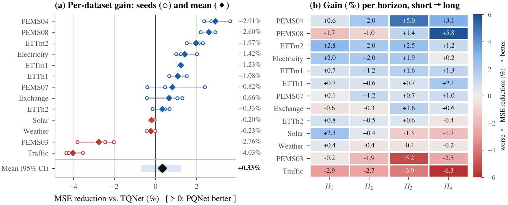

<div align="center">

# PQNet

**Dual-sided periodic memory with data-driven period discovery for multivariate sensor time series forecasting**

[](#installation)
[](https://pytorch.org)
[](LICENSE)
[](tests/test_pqnet.py)

[Idea](#the-idea) · [Quick start](#quick-start) · [Results](#results) · [Reproduce](#reproduce-the-benchmarks)

</div>

Sensor streams from smart meters, transformer probes, weather stations and loop detectors are dominated by daily and weekly cycles. Lightweight forecasters such as CycleNet and TQNet encode this with a learnable table indexed by the phase within a cycle, but they need the cycle length from domain knowledge and use the table in only one place. PQNet uses one phase-indexed memory in two roles and finds the periods itself.

<p align="center">
  
</p>

## The idea

**One periodic memory, two roles.** For a set of periods $\mathcal{P}$, a periodic memory is a sum of learnable $P\times C$ tables read at phase $\tau \bmod P$. PQNet keeps two of them:

| | read at | role | origin |
|---|---|---|---|
| query memory $\mathcal{Q}$ | input phases $t-L,\dots,t-1$ | queries of a channel attention | TQNet |
| residual memory $\mathcal{R}$ | **future** phases $t,\dots,t+H-1$ | periodic baseline added to the forecast | new |

$\mathcal{R}$ starts at zero and costs $\sum_P PC$ parameters. Removing it and fixing $\mathcal{P}=\{W\}$ gives back TQNet exactly.

**Periods from the training split.** A deterministic rule replaces the hand-set cycle length. It scores autocorrelation lags with a periodicity contrast $c(\ell)=a(\ell)-a(\lfloor \ell/2\rfloor)$, which is high for a cycle and near zero for a trend, refines the fundamental over its harmonics, and admits only lags with at least $\rho=10$ repetitions per phase. It proposes a nested hierarchy such as $24 \mid 168$, and the validation loss decides how much of it to use. The test split is never touched.

## Quick start

```bash
git clone https://github.com/baobingzhang/PQNet.git
cd PQNet
pip install -r requirements.txt
python demo.py
```

The demo needs no download and runs on a CPU in about 15 seconds. It builds a synthetic 8-sensor hourly stream with a daily and a weekly cycle, a trend and noise, and is not told the sampling rate:

```text
1. discovered period hierarchy (training split only): [24, 168]
2. PQNet, one model per nested prefix; validation picks the prefix
   periods       [24]  val MSE 0.1562  test MSE 0.1589
   periods  [24, 168]  val MSE 0.1466  test MSE 0.1470
3. test MSE  PQNet [24, 168]: 0.1470   TQNet [24]: 0.1599
4. saved demo_forecast.png
```

<p align="center"></p>

The synthetic series is an illustration of what the method does, not evidence that it works. The evidence is on the benchmarks below.

Using the model in your own code:

```python
import torch
from pqnet import PQNet, discover_periods

periods, _ = discover_periods(train_array)               # (T, C) training split -> e.g. [24, 168]
model = PQNet(seq_len=96, pred_len=96, enc_in=C, periods=periods)
y_hat = model(x, t_end)   # x: (B, 96, C); t_end: (B,) absolute index of the first forecast step
```

## Results

Thirteen benchmarks, four horizons, three seeds (2024 to 2026), look-back 96. TQNet is re-run by us with the official settings on the same hardware and seeds, so every comparison is paired. MSE is averaged over the four horizons; the last column is the paired MSE reduction of PQNet over TQNet (positive means PQNet is better).

| Dataset | Sensors | PQNet MSE | TQNet MSE | Paired gain |
|---|---|---:|---:|---:|
| ETTh1 | transformer load / oil temperature | **0.441** | 0.446 | +1.08% |
| ETTh2 | transformer load / oil temperature | **0.375** | 0.376 | +0.33% |
| ETTm1 | transformer load / oil temperature | **0.374** | 0.379 | +1.23% |
| ETTm2 | transformer load / oil temperature | **0.273** | 0.278 | +1.97% |
| Weather | weather station | 0.243 | **0.242** | -0.23% |
| Electricity | smart meters | **0.162** | 0.164 | +1.42% |
| Traffic | loop detectors | 0.464 | **0.446** | -4.03% |
| Solar | photovoltaic plants | 0.204 | 0.204 | -0.20% |
| PEMS03 | loop detectors | 0.101 | **0.098** | -2.76% |
| PEMS04 | loop detectors | **0.088** | 0.091 | +2.91% |
| PEMS07 | loop detectors | **0.074** | 0.075 | +0.82% |
| PEMS08 | loop detectors | **0.139** | 0.142 | +2.60% |
| Exchange | (exchange rates, no period) | **0.365** | 0.367 | +0.66% |

<p align="center"></p>

What the numbers support, and what they do not:

- PQNet wins 61% of the 156 paired dataset-horizon-seed cells, with a mean MSE reduction of 0.33% (one-sided Wilcoxon on log-ratios, p = 0.0057).
- At the dataset level the effect is small and not significant. PQNet is better on 9 of 13 datasets (sign test p = 0.13), and the 95% hierarchical-bootstrap interval of the mean gain includes zero.
- It is clearly worse on Traffic, where the residual table over-fits the training period, and on PEMS03, where validation gains do not carry over to the test period. The paper analyses both failures.
- The period rule recovers the daily cycle on all twelve periodic benchmarks without being told the sampling rate, finds the yearly cycle (52) of the held-out weekly ILI dataset, and returns no period for exchange rates.

## Reproduce the benchmarks

**Data.** Download the standard long-term forecasting datasets from the [Google Drive folder](https://drive.google.com/file/d/1bNbw1y8VYp-8pkRTqbjoW-TA-G8T0EQf/view) linked by the TQNet, Autoformer and SCINet repositories, and put the files directly into `./dataset/` (for example `./dataset/ETTh1.csv`, `./dataset/PEMS03.npz`, `./dataset/solar_AL.txt`).

**One run.**

```bash
python train.py --dataset ETTh1 --pred_len 96                 # PQNet: discovered periods, validation-selected
python train.py --dataset ETTh1 --pred_len 96 --model tqnet   # TQNet: hand-set cycle, no residual memory
python train.py --dataset Electricity --pred_len 96 --periods 24 168   # fixed periods
```

Learning rate, batch size, dropout and RevIN follow the official TQNet scripts for each dataset (`pqnet/data.py`). Training uses Adam, MSE, at most 30 epochs, early stopping with patience 5, and the best validation checkpoint.

**A full dataset** (four horizons, three seeds, PQNet and TQNet):

```bash
bash scripts/run_dataset.sh ETTh1
```

Reference run on a laptop CPU (12 threads): ETTh1 at horizon 96 takes about 20 seconds per model and gives PQNet MSE 0.3732 vs. TQNet 0.3761, with 661,808 vs. 661,640 parameters. The paper's GPU runs give 0.3699 vs. 0.3724. Identical configurations differ by about 0.7% between CPU and GPU, so compare models on the same device.

## Repository layout

```text
PQNet/
├── pqnet/
│   ├── model.py      # PhaseMemory and PQNet (TQNet is residual=False)
│   ├── periods.py    # period discovery on the training split (Algorithm 1)
│   └── data.py       # benchmark splits, scaling and official per-dataset settings
├── train.py          # one dataset and horizon, with validation-based period selection
├── demo.py           # self-contained demo on synthetic sensor data
├── scripts/run_dataset.sh
├── tests/test_pqnet.py
└── assets/           # figures used in this README
```

```bash
pip install pytest && python -m pytest -q tests   # 10 tests, about 1 second
```

The tests check the claims the method rests on: TQNet is the zero-residual special case, forecasts depend on time only through the phase, the residual is read at the future phases, and the period rule handles trends, random walks, nested cycles and the capacity bound.

## Acknowledgements

PQNet builds on [TQNet](https://github.com/ACAT-SCUT/TQNet) (Lin et al., ICML 2025) and [CycleNet](https://github.com/ACAT-SCUT/CycleNet) (Lin et al., NeurIPS 2024). The data splits and per-dataset settings follow the official TQNet scripts; this repository contains no code copied from them.
